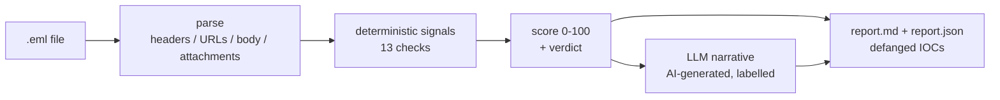

# phish-triage

A SOC-style assistant that reads a suspicious email (`.eml`) and returns a scored verdict with a report: Benign, Suspicious, or Likely Phishing, plus the signal-by-signal reason why.

I spent years on the GRC and security side of an eight-company group, where "is this email safe?" was a question I fielded constantly. This is the first few minutes of that triage automated: the deterministic checks an analyst runs by hand, scored the same way every time. The verdict is decided by heuristics I can defend in an audit, not by a model. A local LLM only writes the human-readable narrative, and it is clearly labelled as AI-generated.

## The problem

Phishing triage is repetitive and easy to get subtly wrong at 9am with a full inbox. The tells are mechanical: a From that disagrees with Reply-To, a brand name in the display name that does not match the sending domain, SPF/DKIM/DMARC failures buried in the headers, a link whose text says `paypal.com` but points somewhere else. A machine should catch those every time and hand the analyst a scored summary. The judgement call stays human.

## What it does

1) Parses the `.eml` with the Python standard library (`email`), no third-party parser.
2) Runs a fixed set of deterministic signals over headers, URLs, body, and attachments.
3) Combines them into a 0-100 risk score and a verdict, with a per-signal breakdown.
4) Asks a local LLM for a short analyst narrative (optional, labelled AI-generated, never moves the score).
5) Writes a `report.md` and a `.json` per email, with every URL and domain defanged.

## Architecture



The score and verdict are produced entirely by steps B through D. The LLM in step E reads the finished findings and writes prose about them. It cannot change the number.

## Quickstart

```bash
git clone https://github.com/aminafara123/phish-triage && cd phish-triage
make install          # venv + pytest (core tool is stdlib-only)
make test             # pytest -q, fully offline
make run              # analyze the bundled samples
```

Or without make:

```bash
python -m phish_triage samples/*.eml            # with AI narrative if a local LLM is up
python -m phish_triage --no-llm samples/*.eml   # deterministic only, no model
```

The AI narrative is optional. If no LLM endpoint is reachable, the tool degrades gracefully and the deterministic report still writes.

## Sample run

```text
$ python -m phish_triage --no-llm samples/*.eml
Likely Phishing  100/100  obvious-phish        -> out/obvious-phish.report.md
Suspicious        30/100  subtle-bec           -> out/subtle-bec.report.md
Benign             0/100  benign-newsletter    -> out/benign-newsletter.report.md
Benign             4/100  benign-google-alert  -> out/benign-google-alert.report.md
```

A slice of `out/obvious-phish.report.md` (every IOC defanged):

```markdown
**Verdict: Likely Phishing**  |  **Risk score: 100/100**

| Signal | Status | Pts | Why |
| --- | --- | ---: | --- |
| Reply-To differs from From | FLAG | 15 | Reply-To secure-refund[.]net vs From paypa1-secure[.]com |
| Display-name brand spoofing | FLAG | 20 | display name claims 'PayPal Security' but From domain is paypa1-secure[.]com |
| DMARC authentication | FLAG | 15 | DMARC=fail |
| Brand-lookalike / typosquat URL | FLAG | 20 | hxxps://paypa1-secure[.]com/verify?... |
| Link text hides a different host | FLAG | 15 | text 'www[.]paypal[.]com' -> paypa1-secure[.]com |
```

The bundled `benign-google-alert.eml` is a real-shaped Google security alert. It uses alarming wording ("Security alert") but passes SPF/DKIM/DMARC from a legitimate domain, so it correctly stays Benign. That is the calibration that matters: the tool does not nuke legitimate security mail.

## The signals

| Signal | Points | What it catches |
| --- | ---: | --- |
| Reply-To differs from From | 15 | replies routed to an attacker domain |
| Return-Path differs from From | 10 | envelope sender does not match the author |
| Display-name brand spoofing | 20 | a brand or domain in the display name that the From domain does not back up |
| SPF authentication | 15 | `spf=fail` / `softfail` in Authentication-Results |
| DKIM authentication | 12 | `dkim=fail` |
| DMARC authentication | 15 | `dmarc=fail` |
| Received-chain sanity | 8 | missing Received headers |
| Punycode / IDN-homograph URL | 20 | `xn--` hosts used to imitate a brand |
| IP-literal URL | 15 | links to a raw IP address |
| URL-shortener link | 10 | bit.ly and friends hiding the real destination |
| Brand-lookalike / typosquat URL | 20 | `paypa1-secure.com` and similar, including digit homoglyphs |
| Link text hides a different host | 15 | anchor text says one domain, href points at another |
| Risky attachment type | 25 / 12 | executables and scripts, or macros / archives / active HTML |
| Urgency / credential-harvest language | up to 15 | "verify within 24 hours", "wire transfer", "keep this confidential", etc. |

Score is the capped sum of the triggered weights. Verdict thresholds: `>= 60` Likely Phishing, `>= 25` Suspicious, else Benign.

## How it works

Everything deterministic lives in four small modules: `parse.py` (eml to structured fields, with defang/refang so the repo holds no live links but the checks still see real hosts), `signals.py` (the 13 checks, each returning a reason), `score.py` (sum, cap, verdict), and `report.py` (markdown + JSON). `llm.py` is a thin OpenAI-compatible client with one function, configured only by environment variables and defaulting to local Ollama. `__init__.py` wires them into `analyze()`, which the CLI and the MCP server both call.

## MCP server (optional)

There is a thin MCP server exposing a single `analyze_email` tool, matching the rest of my MCP-themed portfolio. It needs `pip install mcp` and nothing in the test gate depends on it.

```bash
claude mcp add phish-triage -- python -m phish_triage.mcp_server
```

## Demo


See `DEMO.md` for the 60-second recording script.

## Tech stack

Python 3.10+ standard library for everything deterministic (`email`, `urllib`, `re`). `pytest` for the offline test suite. Optional local LLM via any OpenAI-compatible endpoint (Ollama by default). Optional `mcp` for the server.

## Honesty and safety

The verdict and score are deterministic heuristics, not a verdict of record. The narrative is AI-generated and labelled as such in every report. A human analyst must review before acting. All sample emails are synthetic and all malicious URLs and domains are defanged (`hxxp`, `[.]`) in both the samples and the output.

## License

MIT, see [LICENSE](LICENSE). Copyright 2026 Al Amin Bashir Afara.
